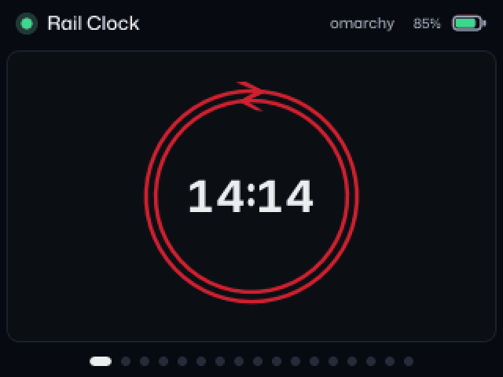

# statsbadge-railclock

A Rail Clock page for [statsbadge](https://github.com/pimoroni/statsbadge) on the Tufty
2350.



The time sits inside two red rings, and each ring carries one chevron of the double arrow.
The outer chevron goes round clockwise and the inner one anticlockwise, each taking a
minute per turn. They meet as the double arrow at the top on the minute, and again at the
bottom on the half minute.

The design follows Network Rail's Rail Clock (Design Bridge and Partners, 2025), as drawn
by the clock tile of my FireTVDeparture departure board:

- **Geometry:** rings of radius 82 and 74.5 in a 200-unit square, with a stroke of 3. The
  chevron arms leave the ring at 27°. The face takes 88% of the page.
- **Colours:** red `#d0202f` and time `#ececec`, on a `#0b0f14` tile with a `#182230`
  border.
- **Time:** `HH:MM` in Inter Bold, with Inter's tabular digits and the raised colon it uses
  between digits.

The badge keeps time off its own clock, set from the computer's, so the chevrons sweep
smoothly and keep going if the computer goes away. Until the first time arrives, the page
reads `--:--`.

## Install

```bash
statsbadge ext add railclock
statsbadge install            # badge on USB: puts the page on it
```

Or type `railclock` into the install box on the config page's **Extensions** tab, then
run `statsbadge install` with the badge on USB. Then add a **Rail Clock** page. It has no
settings.

## The font

`railclock_digits.af` is made from Inter, which is under the SIL Open Font License 1.1
(see `src/statsbadge_railclock/OFL-Inter.txt`). To rebuild it from `InterVariable.ttf`:

1. Fix it at weight 700 and optical size 32 with `fontTools.varLib.instancer`.
2. Point the digits at their tabular forms (`zero.tf` to `nine.tf`) and `:` at
   `colon.case.tf`.
3. Pack it with statsbadge's `tools/make_text_font.py`:

```bash
uv run --group fonts python tools/make_text_font.py InterRailClock.ttf --wide \
    --chars "0123456789:-H" --out railclock_digits.af
```

## Notes

This project is not affiliated with or endorsed by Network Rail or National Rail. The
double arrow symbol is a registered trademark.

The code is MIT licensed; the font is OFL-1.1.
